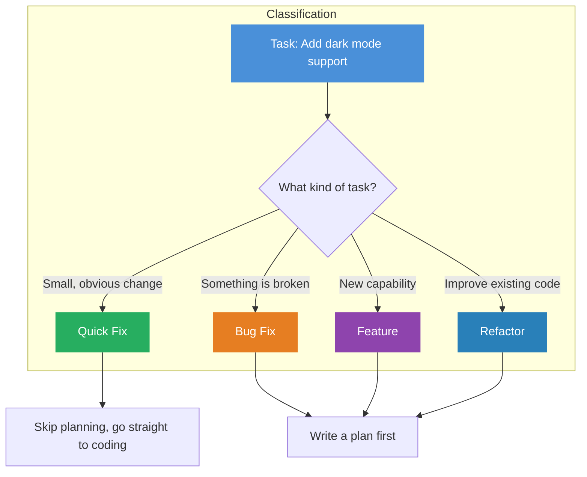
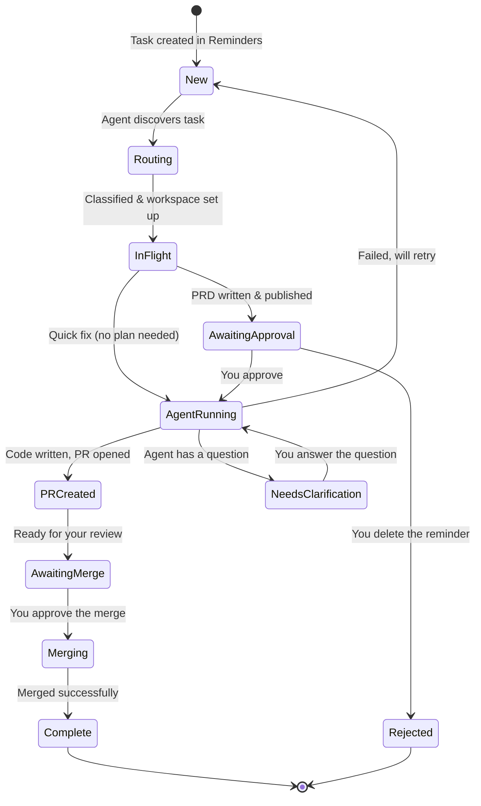
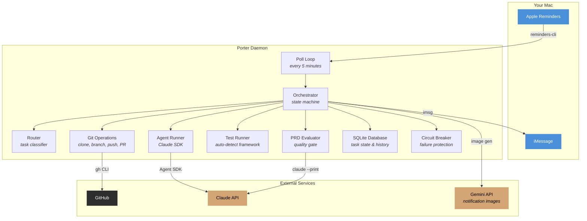

# Porter — How It Works

> **Turn a to-do into a pull request, without writing a line of code.**

Porter is a personal automation system that watches your Apple Reminders for coding tasks and carries them out autonomously — from understanding what needs to be built, to writing the code, to opening a pull request on GitHub.

---

## The Big Picture

**Blue = you do this.** Everything else happens automatically.

You interact with the system entirely through Apple Reminders and iMessage notifications. No terminal, no IDE, no deployment tools. Just write what you want, and the agent handles the rest.

---

## Step by Step

### 1. You Create a Task

Open Apple Reminders and add something like:

> **Task: Add dark mode support**

That's it. The system monitors 10 project lists — each one is linked to a GitHub repository. The word `Task:` at the start tells the agent this is a job for it.

You can also set priority:

> **Task: [P0] Fix login crash** *(critical — gets worked on first)*
> **Task: [P3] Update footer links** *(low priority — queued behind others)*

### 2. The Agent Discovers Your Task

Every 5 minutes, Porter checks all your Reminders lists. When it finds a new task, it:

- **Classifies it** — is this a quick fix, a bug, a new feature, or a refactor? The type determines how much planning is needed.
- **Sends you an iMessage** — "Task received: Add dark mode support"

### 3. A Plan Is Written (For Bigger Tasks)

For features, bug fixes, and refactors, the agent writes a **Product Requirements Document (PRD)** — a structured plan that covers:

- What the change does and why
- Which files and components to modify
- Specific acceptance criteria (how to know it's done)
- Edge cases and error handling
- Testing strategy

The PRD is pushed to a shared GitHub repository where you can read it. A **quality gate** automatically reviews the PRD — if it's too vague or missing key details, the agent rewrites it before you ever see it.

### 4. You Approve the Plan

Your original reminder's title updates to show it's ready for review:

> **[REVIEW PRD] Task: Add dark mode support**

The PRD link appears in the reminder's notes field. You have three options:

| Action | How | What Happens |
|--------|-----|--------------|
| **Approve** | Complete the reminder | Agent starts coding |
| **Request changes** | Change prefix to `[FIX]`, add feedback in notes | Agent revises the plan |
| **Reject** | Delete the reminder | Task is cancelled |

### 5. The AI Writes the Code

Once approved, a Claude AI session begins. It:

1. Reads the entire codebase to understand the architecture
2. Follows the plan step by step
3. Writes the implementation code
4. Writes tests to verify it works
5. Runs the full test suite
6. Commits everything with clear commit messages

This can take anywhere from 2 minutes (quick fix) to 60 minutes (large feature). You get iMessage updates along the way.

> *"Beginning work on 'Add dark mode support'"*
> *"Tests passed for 'Add dark mode support'"*

### 6. A Pull Request Is Created

The agent pushes the code to GitHub and opens a pull request with:

- A summary of what was built
- Link to the PRD
- Number of commits and time taken
- Estimated API cost
- Any test warnings

### 7. You Review and Merge

Your reminder title updates one last time:

> **[MERGE PR #42] Task: Add dark mode support**

Complete it when you're ready, and the agent handles the merge — rebasing onto the latest code, running tests one more time, and merging the PR.

---

## The Full Lifecycle

---

## What Can It Do?

### Six Types of Tasks

| Type | Example | What the Agent Does |
|------|---------|-------------------|
| **Quick Fix** | *"Fix typo in README"* | Makes the change immediately, no plan needed |
| **Bug Fix** | *"Fix login crash on empty email"* | Writes a failing test first, then fixes the bug |
| **Feature** | *"Add dark mode support"* | Full planning cycle with PRD and approval |
| **Refactor** | *"Extract auth into a service layer"* | Incremental changes, tests pass at every step |
| **Analysis** | *"Audit codebase for security issues"* | Read-only — produces a report, no code changes |
| **Composite** | *"Fix all the TODO comments"* | Breaks into sub-tasks and creates new Reminders for each |

### Smart Features

- **Priority ordering** — P0 tasks are worked on before P4 tasks
- **Parallel execution** — up to 5 tasks across different projects at once (but only 1 per project to avoid conflicts)
- **Automatic retries** — if something fails, it tries again with increasing wait times (5 min, 20 min, 80 min)
- **Session recovery** — if the agent crashes mid-task, it picks up where it left off
- **Cost tracking** — every task tracks how many API tokens were used and the estimated cost
- **Daily budget cap** — set a spending limit so tasks pause when the budget is exhausted
- **Task cancellation** — complete the original Reminder while the agent is working to cancel it
- **Merge conflict resolution** — the agent can automatically resolve simple merge conflicts during the merge step

### Notifications

You get iMessage updates at key moments, each with a fun AI-generated banana character image:

- Task received
- Work starting
- Tests passed / failed
- PR created
- Errors and retries
- Merge complete

---

## Architecture

For those who want to peek under the hood:

### Key Components

| Component | What It Does |
|-----------|-------------|
| **Poll Loop** | Checks Reminders every 5 minutes for new tasks and status changes |
| **Orchestrator** | The brain — moves tasks through a 14-state lifecycle |
| **Router** | Looks at the task title and decides what type it is |
| **PRD Evaluator** | Reviews generated plans for quality before showing them to you |
| **Agent Runner** | Manages Claude AI sessions that actually write the code |
| **Test Runner** | Detects which test framework a project uses and runs tests automatically |
| **Git Operations** | Handles cloning repos, creating branches, pushing code, and opening PRs |
| **Circuit Breaker** | If something fails 3 times in a row, it pauses to prevent cascading problems |
| **SQLite Database** | Tracks every task's state, history, and cost — survives crashes |

### Safety Features

The system is designed to be safe by default:

- **You always approve the plan** before any code is written (for non-trivial tasks)
- **You always approve the merge** before code enters your main branch
- **Tests run automatically** before any PR is created
- **Cost limits** prevent runaway spending
- **The agent can't push directly to main** — it always works on a separate branch
- **Every action is logged** in a JSON audit trail

---

## Currently Tracked Projects

| Project | Repository |
|---------|-----------|
| Arcus | welshofer/Splat |
| MangaMaker | welshofer/MangaMaker |
| Juno | welshofer/Juno |
| Sword | welshofer/sword |
| Bolo | welshofer/Bolo |
| Vivere | welshofer/Vivere |
| PhotoVault | welshofer/photovault |
| Incursion | welshofer/incursion |
| Council | welshofer/CouncilOfElders |
| Omaha | welshofer/omaha |

To add a new project: create a Reminders list with the project name, and add its GitHub URL to `config.toml`.

---

## Quick Reference

| What You Want | What To Do |
|--------------|-----------|
| Create a task | Add `Task: <description>` to a project's Reminders list |
| Set priority | Add `[P0]` through `[P4]` to the title |
| Force a task type | Add `[type:quickfix]` or `[type:bugfix]` etc. to the title |
| Approve a plan | Complete the `[REVIEW PRD]` reminder |
| Request plan changes | Change prefix to `[FIX]`, add feedback in notes |
| Reject a plan | Delete the reminder |
| Answer a question | Change prefix to `[ANSWER]`, put answer in notes |
| Merge a PR | Complete the `[MERGE PR #N]` reminder |
| Cancel in-flight work | Complete the original reminder while agent is working |
| Hard kill a task | Run `python3 porter.py --kill-task "name"` |
| Check status | Run `python3 porter.py --status` |
| View all tasks | Run `python3 porter.py --list-tasks` |
| Reset a failed task | Run `python3 porter.py --reset-task "name"` |
